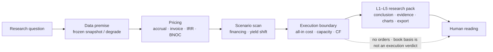

<h1 align="center">CGB Futures CTD / IRR / BNOC Agent</h1>

<p align="center"><a href="README.md">简体中文</a> | <b>English</b></p>

<p align="center">Cheapest-to-deliver, implied repo rate and net basis on a frozen snapshot, with financing and yield-shift scans and an all-in-cost execution boundary.</p>

<p align="center">
  
  
  
  
  
</p>

> This is the local research project `agent-cfe-ctd-irr`. It helps researchers and AI-agent workflows turn CGB futures deliverable selection, financing and CTD-switch scenarios, and an all-in cost gate into **L1–L5 research outputs**. It places no orders, issues no unconditional buy/sell instructions, and makes no return promises. It is not an official or community-listed QuantSkills project and does not claim QuantSkills endorsement.

## What It Helps You Answer

> **Which bond in this deliverable set is CTD, and does the book net basis cover all-in cost?**

## Workflow



## When To Use It

- You need CTD, implied repo rate and net basis reproduced on one frozen snapshot, bond by bond.
- You need to know whether a financing change or a yield-curve shift switches the CTD.
- You need to judge cost coverage, capacity, and whether a conversion-factor error flips the ranking.
- You want the same Agent rules loaded in QuantStudio / Claude Code / Codex / Cursor.

## Deliverables

Local runs write to `reports/runtime_out/<run_id>/`:

| Level | Content | Form |
| --- | --- | --- |
| L1 | One-sentence conditional conclusion | `report.md` / stdout |
| L2 | Bond evidence, dual CTD test, execution boundary | Markdown table |
| L3 | IRR ranking | ASCII |
| L4 | Research dashboard | [`delivery/visualization/index.html`](delivery/visualization/index.html) |
| L5 | Bond table, scans, boundary, gates | CSV / JSON |

Structure sample: [`reports/samples/e2e_ctd_sample.md`](reports/samples/e2e_ctd_sample.md). The sample shows layout only. Open [`delivery/visualization/index.html`](delivery/visualization/index.html) for the current result.

## Directory Layout

```text
agent-cfe-ctd-irr/
├── AGENTS.md                 Agent declaration + behavior entry
├── SKILL.md                  Methodology: inputs, outputs, run, acceptance
├── README.md / README.en.md  Repository homepage
├── LICENSE                   MIT
├── agents/                   Cursor / OpenAI / portable loader / publish manifest
├── runtime/                  Pricing, scenarios, gates, unified CLI
├── scripts/                  Snapshot, rebuild, comparison
├── references/               Data guide, methodology, boundary, acceptance
├── data/                     Frozen snapshot and official-anchor input
├── tests/                    Hard assertions
├── reports/runtime_out/      Two current-semantics runs, plus one v1 acceptance anchor
├── reports/samples/          Structure sample
├── delivery/visualization/   Client page (open index.html)
└── requirements.txt
```

## Quick Start

**Option 1: read the sample** — open [`reports/samples/e2e_ctd_sample.md`](reports/samples/e2e_ctd_sample.md). The client view is [`delivery/visualization/index.html`](delivery/visualization/index.html).

**Option 2: trigger inside an AI agent**

```text
Reproduce CGB futures CTD, IRR and net basis on the frozen snapshot,
compare buy-and-hold with a simple hedge, scan financing and CTD switches,
and state the all-in-cost execution boundary.
Degrade on any data gap and label what is missing. Do not invent numbers,
and do not call a book basis a riskless arbitrage.
```

**Option 3: local CLI**

```powershell
python -m runtime self-test
python -m unittest discover -s tests -v
python -m runtime run --input data/input_snapshot.json
python scripts/rebuild_all.py
```

The calculation path is the Python 3.10+ standard library; `pip install` is not required. Official fetching is optional and needs the `panda_data` SDK. Credentials are read from `~/.pandadata/pandadata.env` into memory. Read `~/.claude/skills/pandadata-api/SKILL.md` before calling it.

`rebuild_all.py` regenerates both runs, the published snapshots, the comparison and the client page, and does not delete existing runs. After correcting historical inputs, add `--refresh-snapshot`.

## Runtime Compatibility

[`AGENTS.md`](AGENTS.md) is the agent declaration and behavior entry. Methodology is in [`SKILL.md`](SKILL.md). Loadable in **QuantStudio, Claude Code, Codex, and Cursor**:

| Runtime | Entry |
| --- | --- |
| Claude Code / Codex | Load this folder's `AGENTS.md`; read `SKILL.md` before calculating |
| Cursor | `agents/cursor-rule.mdc` |
| OpenAI-compatible | `agents/openai.yaml` |
| Other hosts | `agents/portable-loader.md` |
| QuantStudio | Platform paths come from `DSH_HOME` / `QUANTSTUDIO_HOME`; see `agents/portable-loader.md` |

Publish metadata: [`agents/skill-manifest.yaml`](agents/skill-manifest.yaml). Dependency skill: `pandadata-api`.

## Data Sources And Assumptions

- Default pricing input is the frozen snapshot `data/input_snapshot.json` (a declared scenario, `source_mode=degraded`).
- Optional Pandadata calls cover futures quotes, contract delivery terms and macro rate indicators. They do not cover cash bond prices, an exchange conversion factor wired into the calculation, or borrow fees.
- CFFEX public materials (deliverable list, published CF, formulas, delivery rules) are stored under `data/official/` and are not wired into the calculation.
- The official-anchored snapshot, which only replaces the futures price and delivery date, is mixed-source and marked `INVALID_MIXED_STATE`. It is not a market conclusion.
- `data_version` (inputs) and `semantics_version` (calculation; currently `v2-exante-execution`) are independent axes. Under the current semantics the holding is the CTD decided on the settlement date.
- Fields, as-of alignment and gaps: `references/data_guide.md`.

## Limitations And Risk Boundaries

- Research and education only. It validates no return claims and is not investment advice.
- Data gaps must be labeled degraded or insufficient. Do not fill them with assumptions.
- No unconditional order language (buy, sell, guaranteed, raise the position to xx%).
- A book net basis on its own is not an execution verdict. If it does not cover all-in cost, the result stays non-executable.
- A reference-discounted conversion factor is not a substitute for the exchange-published factor.
- No broker connectivity and no live orders (`live_order=false`; the execution check is a declared equivalent replay).
- Not an `alpha-*` production factor package, and it does not emit a tradable parquet.
- This repository is not a QuantSkills community listing. Listing, recommendation, or official recognition still requires maintainer review.

## References

- [`AGENTS.md`](AGENTS.md) — declaration, behavior entry, scenarios, limits, and metadata
- [`SKILL.md`](SKILL.md) — methodology, inputs, outputs, and how to rerun
- [`references/methodology.md`](references/methodology.md) — formulas and ex-ante / ex-post semantics
- [`references/data_guide.md`](references/data_guide.md) — fields and as-of alignment
- [`references/executable_boundary.md`](references/executable_boundary.md) — execution boundary

## Maintainer

Maintained locally (`maintainer_type: local`). Copyright: ProjectAGI, 2026. See [LICENSE](LICENSE).

## License

MIT. See [LICENSE](LICENSE).

## 🐼 PandaAI / QUANTSKILLS Community

<div align="center">
  
  <br>
  <sub>Scan to join the PandaAI community for QUANTSKILLS skills, agent workflows, and quantitative research practice.</sub>
</div>
