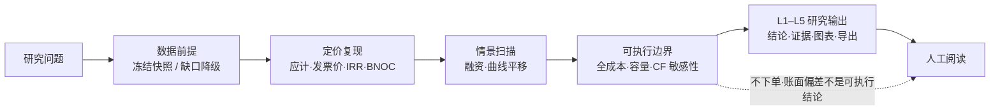

<h1 align="center">国债期货 CTD / IRR / BNOC Agent</h1>

<p align="center"><b>简体中文</b> | <a href="README.en.md">English</a></p>

<p align="center">冻结快照上的最便宜可交割券、隐含回购利率与净基差复现，加上融资 / 曲线情景和全成本可执行边界。</p>

<p align="center">
  
  
  
  
  
</p>

> 这是本地研究项目 `agent-cfe-ctd-irr`：面向研究员与 AI Agent 编排场景，把国债期货交割券判定、融资与 CTD 切换情景、全成本闸门整理成 **L1–L5 研究输出**。不自动下单，不输出无条件买卖指令，也不承诺收益。不是 QuantSkills 官方或社区收录项目；未经维护者审核，不代表 QuantSkills 官方背书。

## 它帮你回答什么

> **这组可交割券里谁是 CTD，账面净基差盖不盖得住全成本？**

## 工作流



## 你什么时候会用它

- 需要在同一张冻结快照上复现 CTD、隐含回购利率和净基差，并逐券对账。
- 要回答「融资变了 CTD 会不会切换」「曲线平移多少会换券」。
- 要判断净基差盖不覆盖全成本、容量有多大、转换因子误差会不会翻判定。
- 希望在 QuantStudio / Claude Code / Codex / Cursor 中加载同一套 Agent 规则。

## 产出一览

本地运行产物写入 `reports/runtime_out/<run_id>/`：

| 层级 | 内容 | 形式 |
| --- | --- | --- |
| L1 | 一句话条件化结论 | `report.md` / stdout |
| L2 | 逐券证据表、CTD 双判据、可执行边界 | Markdown 表 |
| L3 | IRR 排序 | ASCII |
| L4 | 研究仪表盘 | [`delivery/visualization/index.html`](delivery/visualization/index.html) |
| L5 | 逐券表、情景扫描、边界与门禁 | CSV / JSON |

结构样例见 [`reports/samples/e2e_ctd_sample.md`](reports/samples/e2e_ctd_sample.md)。样例只展示版式；打开 [`delivery/visualization/index.html`](delivery/visualization/index.html) 看当前结果。

## 目录结构

```text
agent-cfe-ctd-irr/
├── AGENTS.md                 Agent 声明 + 行为入口
├── SKILL.md                  方法正文：输入输出、运行、验收与边界
├── README.md / README.en.md  仓库主页
├── LICENSE                   MIT
├── agents/                   Cursor / OpenAI / portable loader / 发布清单
├── runtime/                  定价、情景、门禁与统一 CLI
├── scripts/                  快照、重建、对照
├── references/               数据指南、方法论、可执行边界、价值验收
├── data/                     冻结快照与官方锚定输入
├── tests/                    硬断言
├── reports/runtime_out/      当前口径两个 run，外加一份 v1 验收锚
├── reports/samples/          结构样例
├── delivery/visualization/   客户页面（双击 index.html）
└── requirements.txt
```

## 快速开始

**方式一：读样例** —— 打开 [`reports/samples/e2e_ctd_sample.md`](reports/samples/e2e_ctd_sample.md)。客户视图直接打开 [`delivery/visualization/index.html`](delivery/visualization/index.html)。

**方式二：在 AI Agent 里触发**

```text
在冻结快照上复现国债期货 CTD、IRR 和净基差，
对照买入持有与简单对冲，扫描融资和 CTD 切换，给出全成本可执行边界。
缺数据就降级并标明缺什么，不要编造数值，也不要把账面偏差写成无风险套利。
```

**方式三：本机 CLI**

```powershell
python -m runtime self-test
python -m unittest discover -s tests -v
python -m runtime run --input data/input_snapshot.json
python scripts/rebuild_all.py
```

计算主链路是 Python 3.10+ 标准库，不必先 `pip install`。官方数据拉取是可选链路，需要 `panda_data` SDK；凭据只从本机 `~/.pandadata/pandadata.env` 读入内存。调用前先读依赖 Skill `~/.claude/skills/pandadata-api/SKILL.md`。

`rebuild_all.py` 从输入规格重出两个 run、发布快照、对照和客户页面，不删除既有 run。修正历史数据后加 `--refresh-snapshot`。

## 运行时兼容

本仓库以 [`AGENTS.md`](AGENTS.md) 为 Agent 声明与行为入口，方法正文在 [`SKILL.md`](SKILL.md)，可在 **QuantStudio、Claude Code、Codex、Cursor** 中加载：

| 运行时 | 入口 |
| --- | --- |
| Claude Code / Codex | 加载本目录 `AGENTS.md`，计算前读 `SKILL.md` |
| Cursor | `agents/cursor-rule.mdc` |
| OpenAI 兼容 | `agents/openai.yaml` |
| 其他宿主 | `agents/portable-loader.md` |
| QuantStudio | 平台路径由 `DSH_HOME` / `QUANTSTUDIO_HOME` 发现，见 `agents/portable-loader.md` |

发布元数据：[`agents/skill-manifest.yaml`](agents/skill-manifest.yaml)。依赖 Skill：`pandadata-api`。

## 数据来源与假设

- 默认定价输入是冻结快照 `data/input_snapshot.json`（声明式情景，`source_mode=degraded`）。
- 可选的 Pandadata 拉取只覆盖期货行情、合约交割条款和宏观利率指标，不覆盖现券价、公布 CF 接入和借券费率。
- 中金所公开材料（可交割券清单、公布 CF、公式与交割细则）已落盘在 `data/official/`，尚未接入计算。
- 只替换期货价与交割日的官方锚定快照是混合来源，标记为 `INVALID_MIXED_STATE`，不作为市场结论。
- `data_version`（输入）与 `semantics_version`（计算口径，当前 `v2-exante-execution`）是两条独立轴。当前口径下，持仓等于结算日判定的期初 CTD。
- 字段、时点与缺口见 `references/data_guide.md`。

## 限制与风险边界

- 仅供研究与教育参考；不验证任何收益声明，不构成投资建议。
- 数据缺口必须标注为降级 / 证据不足，禁止用假设填补。
- 禁止确定性下单指令（买入 / 卖出 / 必涨 / 仓位提到 xx%）。
- 账面净基差单独不构成可执行结论；全成本覆盖不了就停在不可执行。
- 参考折现得到的转换因子不能冒充交易所公布 CF。
- 不接券商接口、不执行真实委托（`live_order=false`；交易环节是事先声明的等价回放）。
- 不是 `alpha-*` 生产因子包，不产出可交易 parquet。
- 本仓库不是 QuantSkills 社区收录项目；收录、推荐或官方认可仍需维护者审核。

## 参考文档

- [`AGENTS.md`](AGENTS.md) — 项目声明、行为入口、场景、限制与元数据
- [`SKILL.md`](SKILL.md) — 方法正文、输入输出与复跑
- [`references/methodology.md`](references/methodology.md) — 公式与事前 / 事后口径
- [`references/data_guide.md`](references/data_guide.md) — 字段与时点
- [`references/executable_boundary.md`](references/executable_boundary.md) — 可执行边界

## 维护者

本地维护（`maintainer_type: local`）。版权见 [LICENSE](LICENSE)（ProjectAGI，2026）。

## License

MIT。详见 [LICENSE](LICENSE)。

## 🐼 PandaAI / QUANTSKILLS 社群

<div align="center">
  
  <br>
  <sub>扫码加入 PandaAI 社群，交流 QUANTSKILLS 技能、Agent 工作流与量化研究实践。</sub>
</div>
